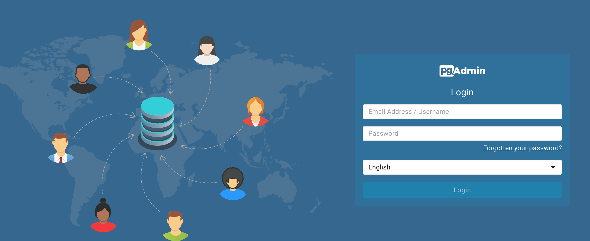

# NYC Taxi Data Pipeline — Dockerised Ingestion
A Dockerised data ingestion pipeline that loads NYC taxi trip data into PostgreSQL.



## What it does

1. Downloads NYC taxi trip data
2. Loads it into PostgreSQL (`ny_taxi` database, `yellow_taxi_trips` table)
3. Includes pgAdmin for visual database management

## Stack

- Language: Python 3.13
- uv (dependency management)
- Data and Database libraries: pandas, SQLAlchemy, psycopg2, tqdm, click
- Database and Admin UI: PostgreSQL 18, pgAdmin 4 (plus optional CLI access via psql or pgcli)
- Containerisation: Docker + Docker Compose

## Files

| File | Purpose |
|------|---------|
| `Dockerfile` | Builds the ingestion image (uv + ingest_data.py) |
| `pyproject.toml` | Python dependencies |
| `uv.lock` | Pinned versions (reproducible builds) |
| `ingest_data.py` | The ingestion script |
| `docker-compose.yaml` | Postgres + pgAdmin + ingestion service |

## How to run

### 1. Start the database and pgAdmin

```bash
1. Start PostgreSQL and pgAdmin in the background:
docker compose up -d pgdatabase pgadmin

2. Run the containerized ingestion pipeline
docker compose up --build ingestion
(Or run docker compose up --build to start all three services together in one command.)

3. Inspect the loaded data (via CLI or pgAdmin):
	a) - Verify row count via psql:
    docker exec -it pipeline-pgdatabase-1 psql -U root -d ny_taxi -c "SELECT count(*) FROM yellow_taxi_trips;"

    b) - Interactive CLI via pgcli:
    pgcli -h localhost -p 5433 -U root -d ny_taxi

    c) Web UI via pgAdmin: Open http://localhost:8085 (admin@admin.com / root) and connect to host pgdatabase on port 5432.

4. Stop containers when finished
    docker compose down

